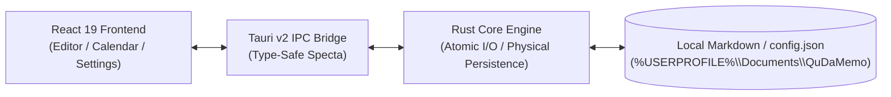

# QuDaMemo (Quick Daily Memo)

[](package.json)
[](https://v2.tauri.app/)
[](https://react.dev/)
[](https://www.typescriptlang.org/)
[](https://www.rust-lang.org/)
[](#-license)

> **Low-resource targeted Daily Markdown Note desktop application powered by Tauri v2, React 19, TypeScript, and Rust.**  
> Engineered for ultra-fast, lightweight daily memoing, under-80MB memory consumption, and seamless Obsidian interoperability with AI-assisted summaries.

**English Version** | [日本語版 (README_JA.md)](README_JA.md)

---

## 🌟 Key Features

- **⚡ Ultra-Fast Daily Note Taking**:
  - Automatic `YYYYMMDD.md` file generation.
  - Automatic YAML Frontmatter injection (`title`, `date`, `weekday`, `holiday`, `tags`, `updated_at`).
- **🤖 Cutting-Edge Gemini AI Summarization**:
  - Defaults to **`gemini-3.7-flash`**, combining state-of-the-art reasoning with ultra-fast latency.
  - Supports model presets (`gemini-2.0-flash`, `gemini-2.5-pro`) and custom manual model identifier inputs for internal proxies or preview endpoints.
  - **Zero-Wait Asynchronous Saving**: Close the editor immediately; AI summarization finishes and saves cleanly in the background.
- **📅 Interactive Calendars & Full-Text Search**:
  - Switch effortlessly between Month Calendar (holiday indicators & task tracking) and Week Calendar (cursor-following dynamic tooltips).
  - High-speed date range filter defaulting to the current month alongside instant full-text keyword search.
- **🛡️ Physical Configuration Persistence & Ironclad Data Safety**:
  - Dual physical persistence saving `config.json` to both the user directory (`%USERPROFILE%\Documents\QuDaMemo\config.json`) and the note storage folder. Preserves API keys across cache flushes.
  - Atomic temporary file writes to prevent data corruption.
- **🪟 Minimalist Frameless UI & Resource Optimization**:
  - Sleek desktop window with frameless transparency (`decorations: false`, `transparent: true`).
  - Strict **<80MB RAM** consumption and **<1% CPU** load during idle states (1Hz throttle).
- **📁 Full Obsidian Compatibility**:
  - Open your note directory directly as an Obsidian Vault for powerful graph exploration and long-term knowledge management.

---

## 🏗️ Architecture Overview

QuDaMemo adopts a clear decoupled architecture separating a **Vite + React 19 frontend** from a **Tauri v2 + Rust native backend**.



---

## ⌨️ Primary Keyboard Shortcuts

| Shortcut             | Action                                                         |
| :------------------- | :------------------------------------------------------------- |
| `Ctrl + N`           | Open / create today's daily memo immediately                   |
| `Ctrl + S`           | Manually save active memo atomically                           |
| `Ctrl + Shift + S`   | Generate Gemini AI summary from current memo content           |
| `Ctrl + F`           | Focus search query input bar                                   |
| `Esc`                | Close active editor and return to calendar/list (or close modal)|
| `F1`                 | Open keyboard shortcuts modal                                  |

---

## 🚀 Quick Start & Development

### Prerequisites
- [Node.js](https://nodejs.org/) (v18.0.0+)
- [Rust](https://www.rust-lang.org/) (v1.80.0+)
- [npm](https://www.npmjs.com/)

### 1. Install Dependencies
```bash
npm install
```

### 2. Run in Development Mode (Hot Reload)
```bash
npx tauri dev
```

### 3. Testing & Verification
```bash
# TypeScript static type check
npm run lint

# Frontend unit tests (Vitest)
npm run test

# Rust backend syntax check
cargo check --manifest-path src-tauri/Cargo.toml

# Rust native unit tests
cargo test --manifest-path src-tauri/Cargo.toml
```

### 4. Build Production Packages
```bash
# Generate native Windows installer (.msi / .exe)
npx tauri build
```

---

## 📚 Documentation Suite

Granular documentation is maintained across multi-language directories under `docs/`:

| Document               | Japanese Version                                          | English Version                                           |
| :--------------------- | :-------------------------------------------------------- | :-------------------------------------------------------- |
| **Specification**      | [docs/ja/SPECIFICATION.md](docs/ja/SPECIFICATION.md)       | [docs/en/SPECIFICATION.md](docs/en/SPECIFICATION.md)       |
| **Architecture**       | [docs/ja/ARCHITECTURE.md](docs/ja/ARCHITECTURE.md)         | [docs/en/ARCHITECTURE.md](docs/en/ARCHITECTURE.md)         |
| **User Guide**         | [docs/ja/USER_GUIDE.md](docs/ja/USER_GUIDE.md)             | [docs/en/USER_GUIDE.md](docs/en/USER_GUIDE.md)             |
| **Development**        | [docs/ja/DEVELOPMENT.md](docs/ja/DEVELOPMENT.md)           | [docs/en/DEVELOPMENT.md](docs/en/DEVELOPMENT.md)           |
| **Task Management**    | [docs/ja/TODO.md](docs/ja/TODO.md)                         | [docs/en/TODO.md](docs/en/TODO.md)                         |
| **Changelog**          | [docs/ja/CHANGELOG.md](docs/ja/CHANGELOG.md)               | [docs/en/CHANGELOG.md](docs/en/CHANGELOG.md)               |
| **Testing Strategy**   | [docs/ja/TESTING.md](docs/ja/TESTING.md)                   | [docs/en/TESTING.md](docs/en/TESTING.md)                   |
| **Test Report**        | [docs/ja/TEST_REPORT.md](docs/ja/TEST_REPORT.md)           | [docs/en/TEST_REPORT.md](docs/en/TEST_REPORT.md)           |
| **Resource Profiling** | [docs/ja/FOOTPRINTS.md](docs/ja/FOOTPRINTS.md)             | [docs/en/FOOTPRINTS.md](docs/en/FOOTPRINTS.md)             |
| **Release Workflow**   | [docs/ja/RELEASE.md](docs/ja/RELEASE.md)                   | [docs/en/RELEASE.md](docs/en/RELEASE.md)                   |
| **Security**           | [docs/ja/SECURITY.md](docs/ja/SECURITY.md)                 | [docs/en/SECURITY.md](docs/en/SECURITY.md)                 |
| **Contribution**       | [docs/ja/CONTRIBUTING.md](docs/ja/CONTRIBUTING.md)         | [docs/en/CONTRIBUTING.md](docs/en/CONTRIBUTING.md)         |
| **Instructions**       | [docs/ja/INSTRUCTIONS.md](docs/ja/INSTRUCTIONS.md)         | [docs/en/INSTRUCTIONS.md](docs/en/INSTRUCTIONS.md)         |

---

## 📄 License

This project is licensed under the **GNU General Public License v3.0 or later (GPL-3.0-or-later)**.  
Copyright (c) 2026 tkshnkgwr. See the [LICENSE](LICENSE) file for details.
