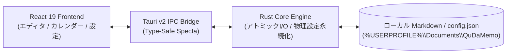

# QuDaMemo (Quick Daily Memo) - 日本語概要

[](package.json)
[](https://v2.tauri.app/)
[](https://react.dev/)
[](https://www.typescriptlang.org/)
[](https://www.rust-lang.org/)
[](#-ライセンス)

> **低リソース環境（スペックの限られたPC）に最適化された、超高速・軽量なデイリーMarkdownメモ＆AI要約デスクトップアプリケーション。**  
> Tauri v2、React 19、TypeScript、および Rust により構築され、メモリ消費量 80MB 未満の軽快な動作と、Obsidian との完全な相互運用性を実現しています。

[English Version (README.md)](README.md) | **日本語版**

---

## 🌟 主な機能と特徴

- **⚡ 超高速デイリーメモ管理**:
  - ファイル命名規則 `YYYYMMDD.md` による自動生成。
  - YAML Frontmatter（タイトル、日付、曜日、祝日名、タグ、`updated_at`）の自動付与。
- **🤖 最先端 Gemini AI 要約エンジン**:
  - 推論と思考速度を両立した最新モデル **`gemini-3.7-flash`** を標準採用。
  - `gemini-2.0-flash`, `gemini-2.5-pro` などのプリセット選択に加え、社内プロキシや最新プレビューモデルの手動直接入力に対応。
  - **待ち時間ゼロの非同期保存**: エディタを即座に閉じても、バックグラウンドスレッドで要約を生成・安全保存。
- **📅 直感的なカレンダー ＆ 全文検索**:
  - 月カレンダー（祝日表示・進捗追従）および週カレンダー（カーソル位置追従ツールチップ）の瞬時切り替え。
  - 当月（1日〜末日）が初期設定された高速日付範囲ピッカーとフリーワード全文検索。
- **🛡️ 物理設定永続化 ＆ データ保護**:
  - 設定ファイル（`config.json`）をユーザーフォルダ（`%USERPROFILE%\Documents\QuDaMemo\config.json`）およびメモ保存先へ二重物理保存。ブラウザキャッシュクリアでも API キーを消失させない堅牢設計。
  - 一時ファイル書き込みとアトミックリネームによるメモ破損防止。
- **🪟 枠なしモダンUI ＆ 超低リソース設計**:
  - 背景透過・ウィンドウ枠なし（`decorations: false`, `transparent: true`）の洗練されたデスクトップデザイン。
  - アイドル時メモリ消費 **80MB 未満**、CPU 占有率 **1% 未満**（1Hz 再描画スロットリング）。
- **📁 Obsidian 完全互換**:
  - メモ保存先フォルダをそのまま Obsidian の Vault（保管庫）として開いてシームレスに相互利用可能。

---

## 🏗️ アーキテクチャ概要

QuDaMemo は **Vite + React 19 フロントエンド** と **Tauri v2 + Rust ネイティブバックエンド** を明確に分離した設計を採用しています。



---

## ⌨️ 主要キーボードショートカット

| キー操作             | 機能・アクション                                               |
| :------------------- | :------------------------------------------------------------- |
| `Ctrl + N`           | 本日のデイリーメモを即座に開く / 新規作成                      |
| `Ctrl + S`           | 編集中メモのアトミック手動保存                                 |
| `Ctrl + Shift + S`   | 現在のメモ本文から Gemini AI 要約を生成                        |
| `Ctrl + F`           | 検索入力バーへフォーカス移動                                   |
| `Esc`                | 編集画面を閉じて一覧/カレンダーへ復帰（またはモーダルを閉じる）|
| `F1`                 | キーボードショートカット一覧モーダルを表示                     |

---

## 🚀 開発・起動手順

### 必須環境
- [Node.js](https://nodejs.org/) (v18.0.0 以上)
- [Rust](https://www.rust-lang.org/) (v1.80.0 以上)
- [npm](https://www.npmjs.com/)

### 1. 依存関係のインストール
```bash
npm install
```

### 2. 開発モードでの起動 (Hot Reload)
```bash
npx tauri dev
```

### 3. テスト ＆ 静的検証
```bash
# TypeScript 型検査
npm run lint

# 単体テスト (Vitest)
npm run test

# Rust バックエンド構文検証
cargo check --manifest-path src-tauri/Cargo.toml

# Rust ネイティブテスト
cargo test --manifest-path src-tauri/Cargo.toml
```

### 4. プロダクションパッケージのビルド
```bash
# Windows ネイティブインストーラ (.msi / .exe) の生成
npx tauri build
```

---

## 📚 ドキュメント体系

プロジェクトの各詳細情報は `docs/` 配下に多言語で体系化されています：

| ドキュメント       | 日本語版                                                  | 英語版                                                    |
| :----------------- | :-------------------------------------------------------- | :-------------------------------------------------------- |
| **機能仕様書**     | [docs/ja/SPECIFICATION.md](docs/ja/SPECIFICATION.md)       | [docs/en/SPECIFICATION.md](docs/en/SPECIFICATION.md)       |
| **アーキテクチャ** | [docs/ja/ARCHITECTURE.md](docs/ja/ARCHITECTURE.md)         | [docs/en/ARCHITECTURE.md](docs/en/ARCHITECTURE.md)         |
| **ユーザーガイド** | [docs/ja/USER_GUIDE.md](docs/ja/USER_GUIDE.md)             | [docs/en/USER_GUIDE.md](docs/en/USER_GUIDE.md)             |
| **開発ガイド**     | [docs/ja/DEVELOPMENT.md](docs/ja/DEVELOPMENT.md)           | [docs/en/DEVELOPMENT.md](docs/en/DEVELOPMENT.md)           |
| **タスク管理**     | [docs/ja/TODO.md](docs/ja/TODO.md)                         | [docs/en/TODO.md](docs/en/TODO.md)                         |
| **変更履歴**       | [docs/ja/CHANGELOG.md](docs/ja/CHANGELOG.md)               | [docs/en/CHANGELOG.md](docs/en/CHANGELOG.md)               |
| **テスト方針**     | [docs/ja/TESTING.md](docs/ja/TESTING.md)                   | [docs/en/TESTING.md](docs/en/TESTING.md)                   |
| **テストレポート** | [docs/ja/TEST_REPORT.md](docs/ja/TEST_REPORT.md)           | [docs/en/TEST_REPORT.md](docs/en/TEST_REPORT.md)           |
| **リソース計測**   | [docs/ja/FOOTPRINTS.md](docs/ja/FOOTPRINTS.md)             | [docs/en/FOOTPRINTS.md](docs/en/FOOTPRINTS.md)             |
| **リリース手順**   | [docs/ja/RELEASE.md](docs/ja/RELEASE.md)                   | [docs/en/RELEASE.md](docs/en/RELEASE.md)                   |
| **セキュリティ**   | [docs/ja/SECURITY.md](docs/ja/SECURITY.md)                 | [docs/en/SECURITY.md](docs/en/SECURITY.md)                 |
| **コントリビュート**| [docs/ja/CONTRIBUTING.md](docs/ja/CONTRIBUTING.md)         | [docs/en/CONTRIBUTING.md](docs/en/CONTRIBUTING.md)         |
| **運用指示書**     | [docs/ja/INSTRUCTIONS.md](docs/ja/INSTRUCTIONS.md)         | [docs/en/INSTRUCTIONS.md](docs/en/INSTRUCTIONS.md)         |

---

## 📄 ライセンス

本プロジェクトは **GNU General Public License v3.0 or later (GPL-3.0-or-later)** のもとで公開されています。  
Copyright (c) 2026 tkshnkgwr. 詳細は [LICENSE](LICENSE) ファイルをご覧ください。
