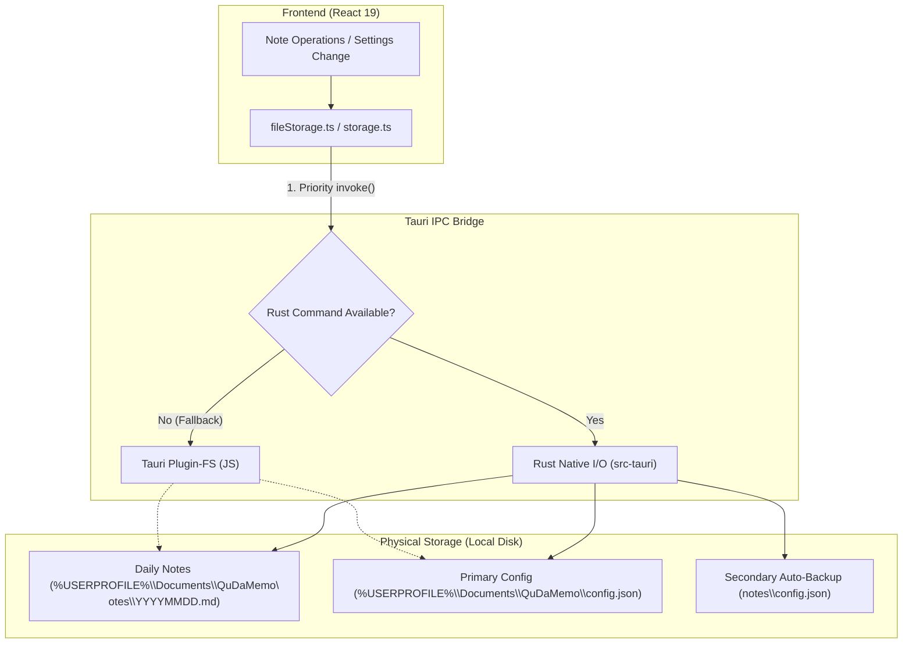

# Architecture (ARCHITECTURE.md) - QuDaMemo

**English** | [日本語版](../ja/ARCHITECTURE.md)

## 1. Overall System Structure

QuDaMemo utilizes a decoupled architecture combining a **Vite + React 19** frontend and a **Tauri v2 Rust** native backend.

```text
+-------------------------------------------------------------+
|                QuDaMemo Tauri v2 Application                |
+-------------------------------------------------------------+
| [Frontend Window]                                           |
| React 19 + TypeScript + TailwindCSS                         |
| (MemoEditor, CalendarView, SearchHeader, SettingsModal)     |
+-------------------------------------------------------------+
| [Tauri Core IPC Bridge]                                     |
+-------------------------------------------------------------+
| [Rust Native Backend (src-tauri)]                           |
| Window Management, Local Storage, Optimization Settings     |
+-------------------------------------------------------------+
```

## 2. System Boundaries and Design Principles

- **UI / Frontend (React 19 / TypeScript)**:
  - Fast note listing, calendar rendering, and Markdown editing via virtual DOM and modular component architecture.
  - Frontmatter parsing, Japanese holiday calculations, and asynchronous Gemini AI summarization.
- **Rust Backend (Tauri v2 / Rust)**:
  - Frameless, transparent modern desktop window framework and single-instance application control.
  - Atomic and secure reading, saving, and deletion of physical note and configuration files.
- **Resource Optimization**:
  - Binary size reduction settings (`opt-level = 'z'`, `lto = true`, `codegen-units = 1`, `strip = true`).
  - Strict re-render throttling maintaining under 80MB idle memory.

---

## 3. Storage & Data Persistence Architecture

QuDaMemo adopts a two-layer defense structure featuring **Native Rust Fast I/O** backed by a **Tauri JS Plugin Fallback**.



### Dual-Backup Persistence
1. **Primary Config**: Persists configurations under `%USERPROFILE%\Documents\QuDaMemo\config.json`.
2. **Secondary Mirroring**: Automatically replicates configurations to `storagePath/config.json` inside the notes folder, ensuring disaster recovery even after webview cache clear.
3. **Browser Storage (LocalStorage)**: Maintained synchronously for zero-latency initial UI rendering on cold boot.

