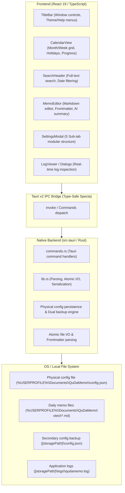
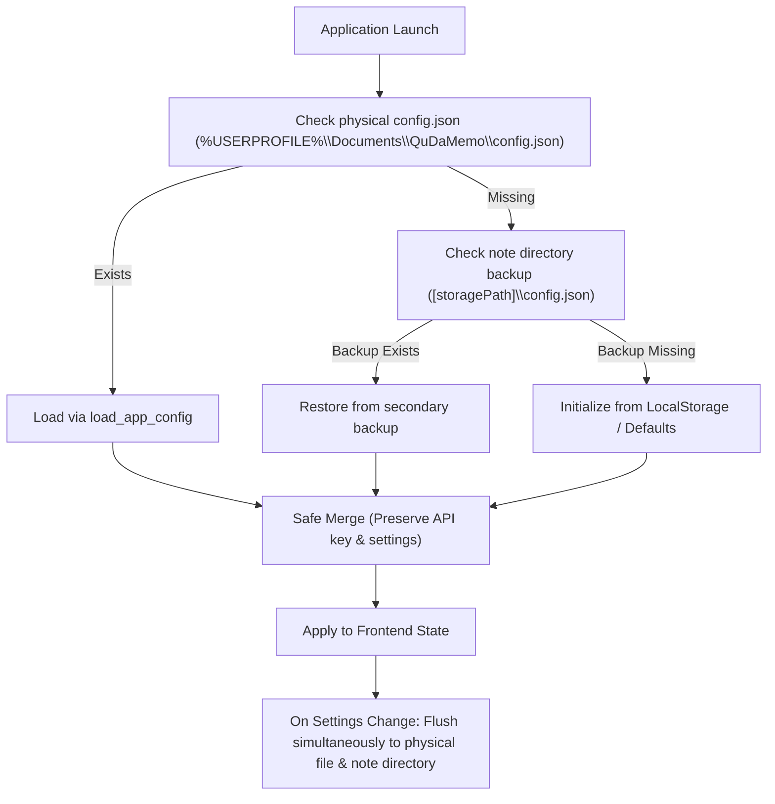

# Architecture & System Design (ARCHITECTURE.md) - QuDaMemo

**English Version** | [日本語版](../ja/ARCHITECTURE.md)

---

## 1. System Overview

QuDaMemo adopts a decoupled desktop architecture combining a **lightweight React 19 + TypeScript frontend powered by Vite** with a **high-performance Tauri v2 + Rust native backend**, designed specifically to balance ultra-fast responsiveness on low-spec hardware with ironclad data durability.



---

## 2. Layered Architecture & Separation of Concerns

QuDaMemo is organized into 4 distinct logical tiers:

| Tier                     | Primary Tech Stack              | Responsibilities & Roles                                                              |
| :----------------------- | :------------------------------ | :------------------------------------------------------------------------------------ |
| **Presentation Tier**    | React 19, TailwindCSS, Lucide   | Rapid UI rendering, editor views, calendar grids, theme switching, modal dialogs      |
| **State & Sync Tier**    | TypeScript, LocalStorage        | UI state handling, memory cache, frontmatter transformations, async AI requests       |
| **Tauri IPC Bridge**     | Tauri v2, Specta, Serde         | Type-safe IPC command dispatch, asynchronous serialization, native OS event mediation |
| **Native Core Tier**     | Rust 1.80+, std::fs, Tempfile   | Atomic disk writes, fast markdown/YAML parsing, physical config persistence, logging  |

---

## 3. Rust Native IPC Command Specification

Communication between frontend and backend is handled through Tauri v2's `invoke` mechanism. All disk I/O and critical data persistence are executed by the Rust backend.

| Command Name        | Arguments                                 | Return Type                     | Description & Operation                                                     |
| :------------------ | :---------------------------------------- | :------------------------------ | :-------------------------------------------------------------------------- |
| `load_all_memos`    | `storage_path: String`                    | `Result<Vec<QuickMemoDto>, String>` | Scans note directory, parsing frontmatter and content into DTOs in one pass |
| `save_memo_file`    | `storage_path: String, memo: QuickMemoDto`| `Result<(), String>`            | Writes to a temporary file and atomically renames to prevent file corruption|
| `delete_memo_file`  | `storage_path: String, memo_id: String`   | `Result<(), String>`            | Safely removes the targeted `YYYYMMDD.md` file from disk                    |
| `save_app_config`   | `config_path: String, config_json: String`| `Result<(), String>`            | Safely flushes configuration JSON to physical disk                          |
| `load_app_config`   | `config_path: String`                     | `Result<String, String>`        | Reads physical configuration file and returns serialized JSON string        |

---

## 4. Physical Config Persistence & Dual Backup Flow

To safeguard user settings and Gemini API keys against browser cache purges or OS-level cleaner scripts, QuDaMemo leverages a **Rust Native Physical Persistence & Dual Backup Architecture**.



---

## 5. Low-Resource & Performance Optimization Design

QuDaMemo is specifically tuned for optimal responsiveness on low-specification PCs (constrained CPU & RAM environments):

- **Minimal Memory Footprint**:
  - Maintains under **80 MB RAM** during typical idle and viewing operations.
  - Efficient component lifecycles that prevent memory leaks and unneeded DOM allocations.
- **1Hz Re-render Throttling**:
  - Clocks and polling intervals are capped to 1Hz, maintaining background CPU utilization strictly under 1%.
- **Aggressive Rust Release Optimization (`Cargo.toml`)**:
  ```toml
  [profile.release]
  opt-level = 'z'     # Optimize for minimum binary size
  lto = true          # Enable Link-Time Optimization across crates
  codegen-units = 1   # Single code generation unit for maximum optimization
  panic = 'abort'     # Remove stack unwinding code to reduce binary size
  strip = true        # Completely strip debug symbols from binary
  ```
- **Lightweight Frameless Window**:
  - Configured with `decorations: false`, `transparent: true`, and `shadow: false` in `tauri.conf.json` for hardware-accelerated minimalist rendering.
