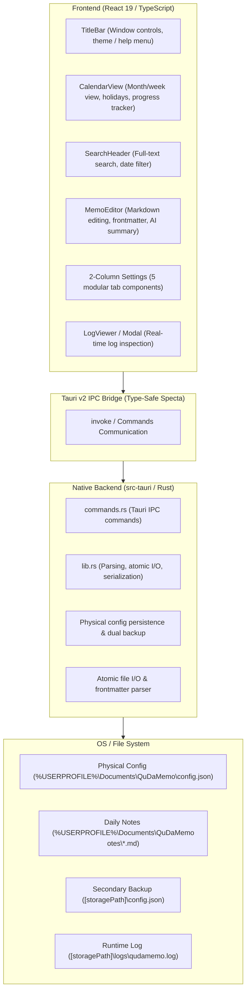
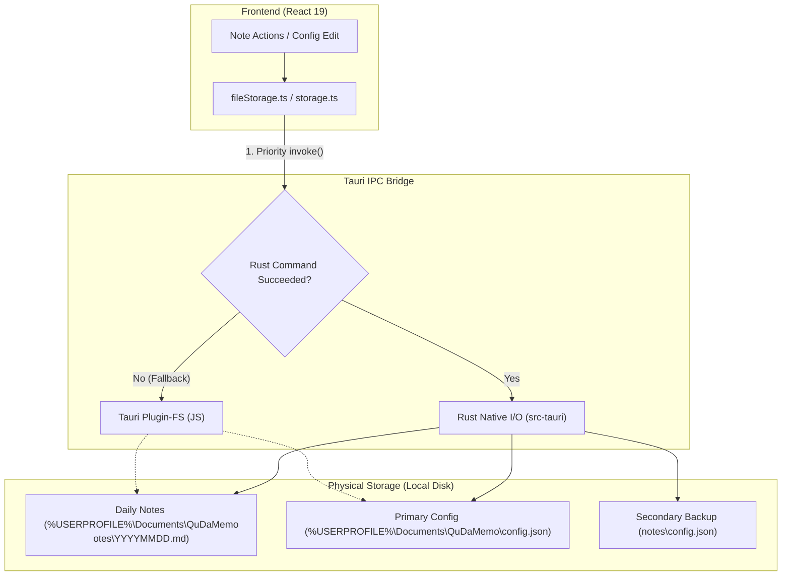
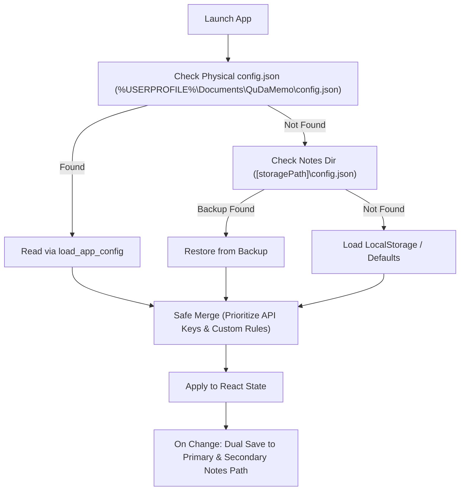

# System Architecture (ARCHITECTURE.md) - QuDaMemo

**English Version** | [日本語版](../ja/ARCHITECTURE.md)

---

## 1. System Overview

QuDaMemo adopts a decoupled desktop architecture combining a **lightweight React 19 + TypeScript + Vite frontend** with a **high-performance Tauri v2 + Rust native backend**, ensuring ultra-fast execution even in resource-constrained PC environments while guaranteeing robust data safety.



---

## 2. System Boundaries & Layered Architecture

QuDaMemo is organized into 4 logical architectural layers:

| Layer               | Core Technologies             | Key Responsibilities & Role                                            |
| :------------------ | :---------------------------- | :--------------------------------------------------------------------- |
| **Presentation**    | React 19, TailwindCSS, Lucide | Fast UI rendering, editor, calendar view, theme & modal control        |
| **State & Sync**    | TypeScript, LocalStorage      | UI state, temporary caching, frontmatter conversion, AI async requests |
| **Tauri IPC Bridge**| Tauri v2, Specta, Serde       | Type-safe IPC, asynchronous serialization, native OS event handling    |
| **Native Core**     | Rust 1.80+, std::fs, Tempfile | Atomic file writes, fast Markdown parsing, config persistence, logs    |

- **UI / Frontend (React 19 / TypeScript)**:
  - Fast note listing, calendar rendering, and Markdown editing via virtual DOM and modular component architecture.
  - Frontmatter parsing, Japanese holiday calculations, and asynchronous Gemini AI summarization.
- **Rust Backend (Tauri v2 / Rust)**:
  - Frameless, transparent modern desktop window framework and single-instance application control.
  - Atomic and secure reading, saving, and deletion of physical note and configuration files.
- **Resource Optimization**:
  - Binary size reduction settings (`opt-level = 'z'`, `lto = true`, `codegen-units = 1`, `strip = true`).
  - Strict re-render throttling maintaining under 80MB idle memory.

---

## 3. Rust Native IPC Command Specification

Communication between the frontend and native backend flows strictly through Tauri v2's `invoke` channel. All disk I/O and persistence are executed in Rust:

| Command Name        | Arguments                                 | Return Type                          | Role & Functional Behavior                                      |
| :------------------ | :---------------------------------------- | :----------------------------------- | :-------------------------------------------------------------- |
| `load_all_memos`    | `storage_path: String`                    | `Result<Vec<QuickMemoDto>, String>`| Traverses notes directory to parse frontmatter and body in bulk |
| `save_memo_file`    | `storage_path: String, memo: QuickMemoDto`| `Result<(), String>`               | Writes to a temporary file then atomically renames to save      |
| `delete_memo_file`  | `storage_path: String, memo_id: String`   | `Result<(), String>`               | Safely removes target `YYYYMMDD.md` from physical disk        |
| `save_app_config`   | `config_path: String, config_json: String`| `Result<(), String>`               | Writes configuration JSON directly to physical file path        |
| `load_app_config`   | `config_path: String`                     | `Result<String, String>`           | Reads physical configuration file and returns JSON string       |

---

## 4. Storage & Persistence Architecture

QuDaMemo utilizes a two-layer defense architecture featuring **Rust Native Fast I/O** supported by a **Tauri JS Plugin Fallback**.



### Dual-Backup Physical Configuration Flow

To prevent settings and API key loss during WebView2 cache clears or app updates, QuDaMemo implements a **Rust native physical persistence & secondary mirror backup mechanism**:

1. **Primary Config**: Physical persistence under `%USERPROFILE%\Documents\QuDaMemo\config.json`.
2. **Secondary Mirror**: Replicates to note directory (`storagePath/config.json`) on every save to ensure recovery during system migration.
3. **Browser Cache (LocalStorage)**: Maintained for instant rendering on application cold boot.



---

## 5. Low-Resource & Performance Optimization

Engineered specifically for snappy performance on low-spec PCs (constrained CPU/RAM):

- **Minimal Memory Footprint**:
  - Maintains under **80 MB RAM** during idle state.
  - Efficient DOM lifecycle management and minimal state overhead.
- **Throttled Render Intervals (1Hz Throttle)**:
  - Real-time clocks and status updates throttled to at most once per second, keeping idle CPU under 1%.
- **Aggressive Rust Release Compilation (`Cargo.toml`)**:
  ```toml
  [profile.release]
  opt-level = 'z'     # Size optimization
  lto = true          # Link Time Optimization
  codegen-units = 1   # Single unit for maximum optimizations
  panic = 'abort'     # Remove stack unwinding code
  strip = true        # Strip debug symbols
  ```
- **Frameless Transparent Window**:
  - Configured with `decorations: false`, `transparent: true`, `shadow: false` in `tauri.conf.json` to leverage lightweight OS-native rendering.
