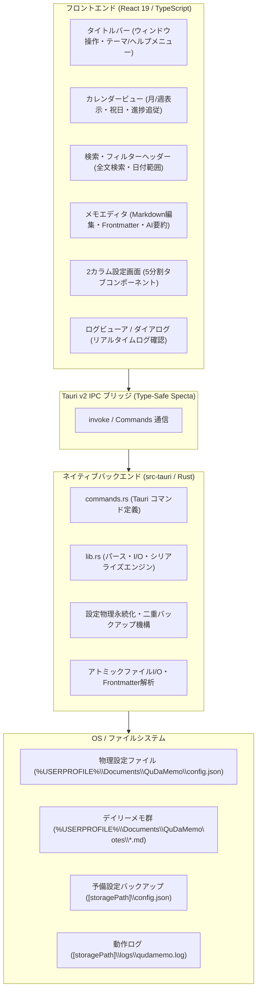
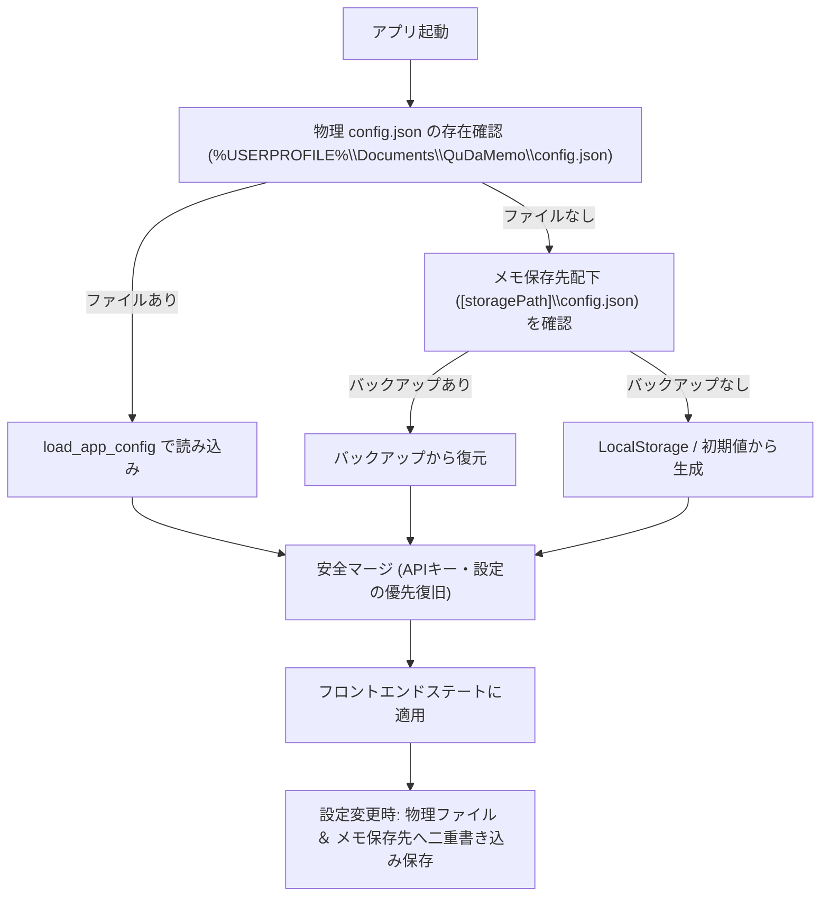

# アーキテクチャ構成 (ARCHITECTURE.md) - QuDaMemo

[English Version](../en/ARCHITECTURE.md) | **日本語版**

---

## 1. システム全体概要

QuDaMemo は、低リソース環境（低スペックPC）での軽快な動作と堅牢なデータ安全性を両立するため、**React 19 + TypeScript + Vite による軽量フロントエンド** と **Tauri v2 + Rust による高性能ネイティブバックエンド** を明確に分離したデスクトップアーキテクチャを採用しています。



---

## 2. システム境界とレイヤー構成

QuDaMemo は以下の 4 つの論理レイヤーで構成されています。

| レイヤー           | 主要技術スタック                | 責務と役割                                                                     |
| :----------------- | :------------------------------ | :----------------------------------------------------------------------------- |
| **プレゼンテーション層** | React 19, TailwindCSS, Lucide   | 高速レンダリング、エディタUI、カレンダー表示、テーマ制御、モーダル管理         |
| **ステート＆同期層**     | TypeScript, LocalStorage        | UIステート管理、一時キャッシュ、フロントマター相互変換、AI要約非同期リクエスト |
| **Tauri IPC ブリッジ**   | Tauri v2, Specta, Serde         | 型安全なIPC通信、非同期シリアライゼーション、OSネイティブイベント仲介         |
| **ネイティブコア層**     | Rust 1.80+, std::fs, Tempfile   | アトミックファイル保存、高速Markdownパース、物理設定永続化、ログローテーション |

---

## 3. Rust ネイティブ IPC コマンド仕様

フロントエンドとバックエンドの通信は、Tauri v2 の `invoke` 機構を通じて行われます。すべてのファイルI/Oおよび永続化処理は Rust バックエンドが担います。

| コマンド名          | 引数                                      | 返り値                          | 役割と処理内容                                                 |
| :------------------ | :---------------------------------------- | :------------------------------ | :------------------------------------------------------------- |
| `load_all_memos`    | `storage_path: String`                    | `Result<Vec<QuickMemoDto>, String>` | 保存先フォルダ内の全 `.md` を走査し、Frontmatterと本文を一括パース |
| `save_memo_file`    | `storage_path: String, memo: QuickMemoDto`| `Result<(), String>`            | 一時ファイル書き込み後にアトミックリネームで安全保存           |
| `delete_memo_file`  | `storage_path: String, memo_id: String`   | `Result<(), String>`            | 対象の `YYYYMMDD.md` ファイルを安全に物理削除                  |
| `save_app_config`   | `config_path: String, config_json: String`| `Result<(), String>`            | 設定JSONを物理パスへ確実に書き込み保存                         |
| `load_app_config`   | `config_path: String`                     | `Result<String, String>`        | 物理設定ファイルを読み込み、JSON文字列を返却                   |

---

## 4. 設定ファイルの物理永続化 ＆ 二重バックアップフロー

WebView2 のブラウザキャッシュクリアやアプリ更新時でも API キーや設定が消失しないよう、**Rust ネイティブ物理永続化 ＆ 二重バックアップ機構** を導入しています。



---

## 5. 低リソース ＆ パフォーマンス最適化設計

低スペックPC（CPU/RAMが限られた環境）で常に軽快に動作するための最適化施策を徹底しています。

- **メモリ消費量の極小化**:
  - アイドル時メモリ消費量を **80 MB 未満** に維持。
  - 不要なDOM要素の破棄と軽量なステート更新サイクル。
- **再描画インターバル制限 (1Hz Throttle)**:
  - リアルタイム時計やステータス更新のタイマーを 1 秒あたり最大 1 回に抑制し、CPU 占有率を 1% 未満に維持。
- **Rust リリースビルドの徹底最適化 (`Cargo.toml`)**:
  ```toml
  [profile.release]
  opt-level = 'z'     # バイナリサイズ優先の最適化
  lto = true          # リンク時最適化 (Link Time Optimization)
  codegen-units = 1   # コンパイル単位を1に集約し最適化を最大化
  panic = 'abort'     # スタック巻き戻しコードを除去してサイズ削減
  strip = true        # デバッグシンボルを完全ストリップ
  ```
- **枠なし透過ウィンドウ**:
  - `tauri.conf.json` で `decorations: false`, `transparent: true`, `shadow: false` を採用し、OSネイティブの軽量グラフィック描画を活用。
