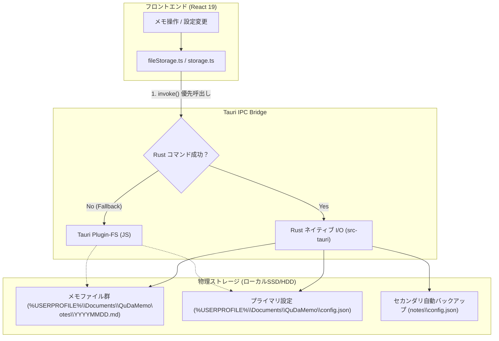

# アーキテクチャ構成 (ARCHITECTURE.md) - QuDaMemo

[English Version](../en/ARCHITECTURE.md) | **日本語版**

## 1. 全体構造概要

QuDaMemo は **Vite + React 19 フロントエンド** と **Tauri v2 Rust バックエンド** の分離アーキテクチャを採用しています。

```text
+-------------------------------------------------------------+
|                QuDaMemo Tauri v2 Application                |
+-------------------------------------------------------------+
| [Frontend Window]                                           |
| React 19 + TypeScript + TailwindCSS                         |
| (MemoEditor, CalendarView, SearchHeader, SettingsModal)     |
+-------------------------------------------------------------+
| [Tauri Core IPC Bridge]                                     |
+-------------------------------------------------------------+
| [Rust Native Backend (src-tauri)]                           |
| Window Management, Local Storage, Optimization Settings     |
+-------------------------------------------------------------+
```

## 2. システム境界と設計原則

- **UI / フロントエンド (React 19 / TypeScript)**:
  - 仮想DOMとコンポーネント分離による高速なメモ一覧表示・カレンダー表示・マークダウン編集。
  - フロントマター解析・祝日計算・非同期Gemini AI要約連携。
- **Rust バックエンド (Tauri v2 / Rust)**:
  - ウィンドウ透過・枠なしモダンフレームワークの提供、シングルインスタンス制御。
  - 物理メモファイルおよび設定ファイルのアトミックな読み込み・保存・削除。
- **リソース最適化**:
  - バイナリサイズ削減設定（`opt-level = 'z'`, `lto = true`, `codegen-units = 1`, `strip = true`）。
  - 不要な再描画の抑制とアイドル時メモリ 80MB 未満の徹底。

---

## 3. ストレージ ＆ データ永続化アーキテクチャ

QuDaMemo は **Rust ネイティブ高速 I/O** と **Tauri JS プラグインフォールバック** の二層防御構造を採用しています。



### 二重バックアップ永続化
1. **プライマリ設定**: ユーザーマイドキュメント直下の `%USERPROFILE%\Documents\QuDaMemo\config.json` に設定を永続化。
2. **セカンダリ二重保存**: メモ保存先フォルダ直下 (`storagePath/config.json`) にも同時に書き込みを行い、キャッシュクリアや別PC移行時の設定復元を保証。
3. **ブラウザキャッシュ (LocalStorage)**: 起動時の即時描画用オフラインキャッシュとして同期維持。

